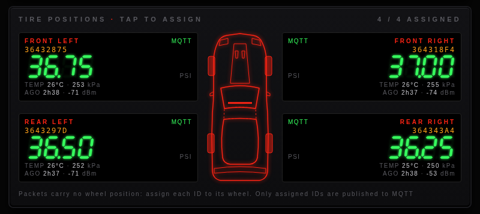
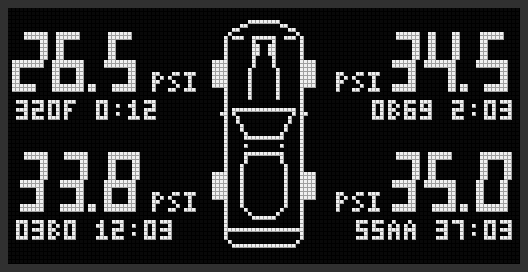
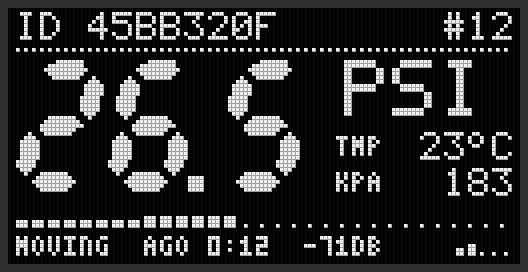

# fordtpms

A stand-alone receiver for Ford tire pressure sensors. An ESP32 and a
315 MHz radio pick up each wheel's pressure and temperature as the sensors
transmit. The readings show on an OLED display, in a web dashboard on the
local network, and are published to Home Assistant over MQTT.



## Features

- **Decodes Ford TPMS sensors** (the VDO/Continental family that rtl_433 calls
  `tpms_ford`): sensor ID, pressure, temperature and moving/parked/learn mode.
  Each sensor sends a burst of about 4 repeats, which are folded into one
  reading.
- **OLED display** (128×64 SSD1306) in a digital dashboard style: a
  four-wheel overview, a detail screen per sensor, and a scanner screen while
  waiting. It dims when idle and shifts its pixels to reduce burn-in.
- **Web dashboard** that updates live over WebSocket. It shows signal strength,
  all four tires on a car diagram, an RF history graph, receiver statistics, a
  log of every sensor heard and a per-sensor packet history. The OLED screen
  is mirrored on a page of its own.
- **Home Assistant**: each tire is assigned to a wheel position in the web UI
  and published over MQTT with automatic discovery.
- **Receiver tuning from the browser**: frequency, bandwidth, sync word and chip
  rate. On the CC1101, automatic frequency correction follows the sensors'
  carrier offset.
- **Firmware updates over Wi-Fi**, with automatic rollback if the new image
  fails to come up.
- **Serial command line** for setup, diagnostics and raw packet capture.

<p>


</p>

## Hardware

| Microcontroller | Radio | Notes |
|---|---|---|
| ESP32 (WROOM-32 DevKit) | TI CC1101 | Main target. 315 MHz is inside the CC1101's specified bands |
| ESP32-C3 | Semtech LR1121 | ExpressLRS "Unified ESP32C3 LR1121" receiver boards |

The OLED is optional. Wiring and pin choices are in
[firmware/README.md](firmware/README.md#hardware).

## Installation

Requires [PlatformIO](https://platformio.org/install). To build and flash the
ESP32 + CC1101 version over USB:

```bash
cd firmware && pio run -e esp32-cc1101 -t upload
```

## Credits

The packet decoder is a port of
[rtl_433](https://github.com/merbanan/rtl_433)'s `tpms_ford` decoder, and its
tests run against real sensor recordings from
[rtl_433_tests](https://github.com/merbanan/rtl_433_tests). The LR1121 front-end settings
follow the [ExpressLRS](https://github.com/ExpressLRS/ExpressLRS) driver for
the same hardware.

[GPL-2.0](LICENSE), the same as rtl_433.

## Documentation

- [firmware/README.md](firmware/README.md): hardware, building, Wi-Fi and MQTT
  setup, how reception works, troubleshooting
- [docs/UI.md](docs/UI.md): every OLED screen explained
- [docs/CLI.md](docs/CLI.md): serial command reference
