# OLED user interface

The 128x64 SSD1306 OLED has three screens. They are styled after late-1980s
digital car dashboards: slanted 7-segment digits with beveled segments,
segmented bar graphs, and an outlined car.

> The screenshots are rendered on the host by `firmware/test/host/ui_preview.c`,
> which runs the same `ui.c` / `gfx.c` code as the firmware, and are shown at
> 4x scale. Regenerate them with `make -C firmware/test/host screenshots`
> (needs ImageMagick). The sample data is made up. To see the live frame on the
> device, use the `screen` CLI command.

## Screen schedule

| Situation | Screen |
|---|---|
| No sensor received since boot | [Idle / scan](#idle--scan-screen) |
| A new reading arrived in the last 20 s | [Detail](#detail-screen) of that sensor |
| Later | Rotation: [Overview](#overview-screen) for 8 s, then the detail of each of the (up to 4) most recent sensors for 5 s each |

A new reading interrupts the rotation and shows its detail screen
immediately. After the 20 s the rotation restarts from the overview.

---

## Idle / scan screen

Shown from power-up until the first valid packet is received.

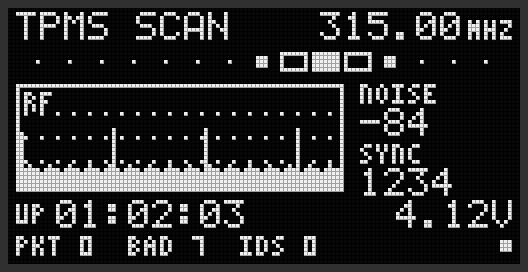

| Area | Content |
|---|---|
| Top left | `TPMS SCAN` title |
| Top right | Receive frequency in MHz (`radio freq`) |
| Scanner bar | 15 blocks; a lit block sweeps left and right with a fading tail. Shows that the firmware is running |
| Graph (`RF`) | Scrolling RF level history. Each column is the **peak** RSSI over 500 ms. The web UI's box spans the last 30 s, the OLED idle graph 40 s. Scale is about −95 dBm (bottom) to −35 dBm (top), with dotted grid lines at −80, −65 and −50 dBm. A spike is a burst of 315 MHz energy from something nearby |
| `NOISE` | Smoothed noise floor in dBm, as the radio reports it |
| `SYNC` | Number of times the radio matched the sync word. This climbs slowly even without sensors, because noise sometimes matches (roughly every 5–10 s) |
| `UP` | Uptime, `hh:mm:ss` |
| Bottom line | `PKT` valid Ford packets decoded over the air · `BAD` packets rejected at the Manchester, checksum or flag check · `IDS` unique sensors in the table |
| Bottom right corner | Receive lamp: alternates filled and outlined, one cycle every 1.2 s |

---

## Detail screen

One sensor's latest reading. It appears for 20 s after every new
transmission, and for 5 s per sensor during the rotation.

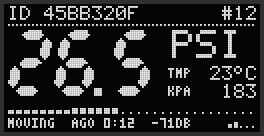

| Area | Content |
|---|---|
| Top left | `ID` sensor ID (8 hex digits, as in rtl_433) |
| Top right | `#n`: number of transmissions (bursts) received from this ID. A sensor repeats each reading about 4 times; the repeats count as one. If the ID is assigned to a wheel, the wheel comes first, e.g. `FR #12` |
| Big digits | Pressure in **PSI**, rounded to 0.1. At 100 PSI and above, whole PSI are shown (see the learn example below) |
| `TMP` | Temperature in °C, or `--` when this packet's temperature byte isn't a temperature (bit 0x80 set) |
| `KPA` | Pressure in kPa |
| Wedge bar | Pressure on a 0–60 PSI scale. 31 segments that get taller to the right; unlit segments show as dots |
| Bottom line | Alternates every 3 s, see below |
| Bottom right | Signal-strength bars (best RSSI of the latest burst). 1 bar ≥ −88 dBm, 2 ≥ −78, 3 ≥ −70, 4 ≥ −60, 5 ≥ −50 |

The bottom line alternates between two views every 3 s:

**Status view** (above): mode, age and signal strength.
- Mode is `MOVING`, `AT REST` or `LEARN`.
- `AGO m:ss` is the time since the last packet from this sensor. After an
  hour it switches to `hHmm`, and after 100 h to `nD`.
- The last field is RSSI in dBm.

**Packet view**: raw packet fields.

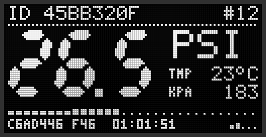

- `C6AD446`: the rtl_433 `code` field (bytes 4–6 of the packet: pressure,
  temperature, flags).
- `F46`: the flags byte.
- `01:01:51`: device uptime when the packet was received. There is no
  wall clock while Wi-Fi is off.

**Just received**: for the first 1.5 s after a new packet, a frame flashes
around the digits.

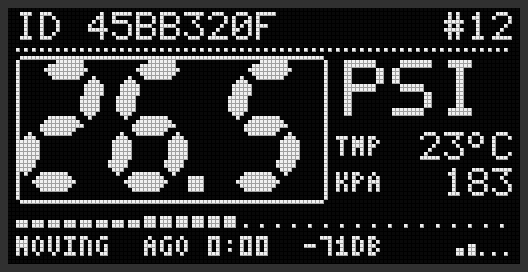

**Learn mode / high pressure / no temperature**: a sensor triggered by a TPMS
learn tool shows `LEARN`. Pressures of 100 PSI and above use the 9th pressure
bit (flag 0x20) and are shown as whole PSI. An invalid temperature shows `--`.

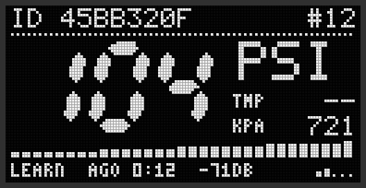

---

## Overview screen

A top-down car with a sensor in each corner. Ford packets don't say which
wheel a sensor is on, so what the corners show depends on whether you have
assigned IDs to wheels (web UI Tire Positions panel, or the `tires` CLI command).

**No wheels assigned:** the four most recently heard sensors, filled
newest-first: top-left, top-right, bottom-left, bottom-right. A corner with no
sensor shows `---`.

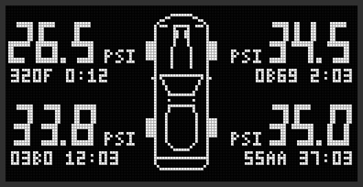

Each corner shows the pressure in PSI. Under it is a line that alternates every 4 s:

- the last 4 hex digits of the sensor ID and the time since it was last heard (above)
- the temperature and `MOV` if the sensor is moving. Without a valid
  temperature, the ID is shown instead (below, bottom-left)

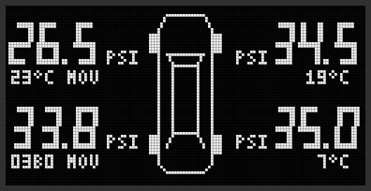

**At least one wheel assigned:** each corner is its wheel: front left,
front right, rear left, rear right. Sensors that aren't assigned don't appear
here, but they still get detail screens in the rotation.

| Corner shows | Meaning |
|---|---|
| Pressure and the same alternating line as above | Assigned and heard since boot |
| `--.-` PSI and the ID's last 4 hex digits with a blinking `WAIT` | Assigned but not heard since boot (parked sensors transmit only about every 6 h) |
| `---` | No sensor assigned to this wheel |

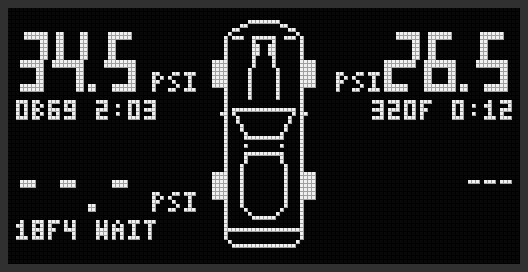

The detail screen of an assigned sensor shows its wheel in the header:

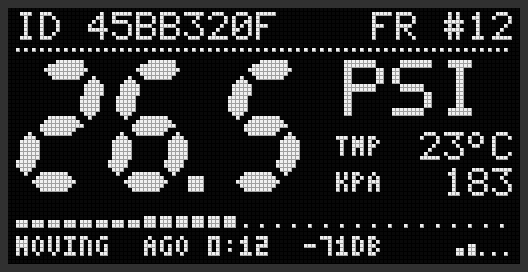

---`.

Each corner shows the pressure in PSI. Under it is a line that alternates every 4 s:

- the last 4 hex digits of the sensor ID and the time since it was last heard (above)
- the temperature and `MOV` if the sensor is moving. Without a valid
  temperature, the ID is shown instead (below, bottom-left)

---

## Burn-in protection

These apply to every screen.

### Pixel shift

Every layout is drawn on a 124x61 canvas inside the 128x64 panel. The canvas
steps through all 5 x 4 = 20 offsets, one pixel every 30 s
(`display shift <s>`), in a back-and-forth path, so static
text and lines never sit on the same pixels for long. A full cycle takes
10 minutes.

| Offset (0,0) | Offset (4,3) |
|---|---|
| 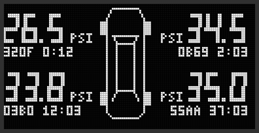 | 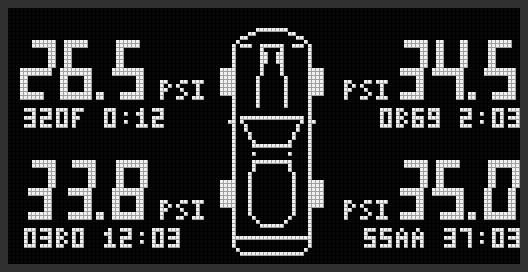 |

### Dimming

After 120 s without a new transmission (`display dim_after <s>`), the contrast
drops from 143 to 1 (`display bright`, `display dim`). The display is
**never switched off**. The next received packet, or `display wake`, restores
full brightness. On the idle screen the timer runs from boot, so a receiver
waiting for its first packet dims after 2 minutes.

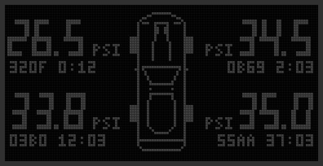

*The image only illustrates the effect. At contrast 1 the real panel is dim but still lit; it is never turned off.*

### Moving elements

The scanner bar, receive lamp, scrolling graph, flashing frame, and
alternating text lines change pixels continuously.

## LED

The LED on GPIO25 flashes for 60 ms on every decoded packet, including repeats.
